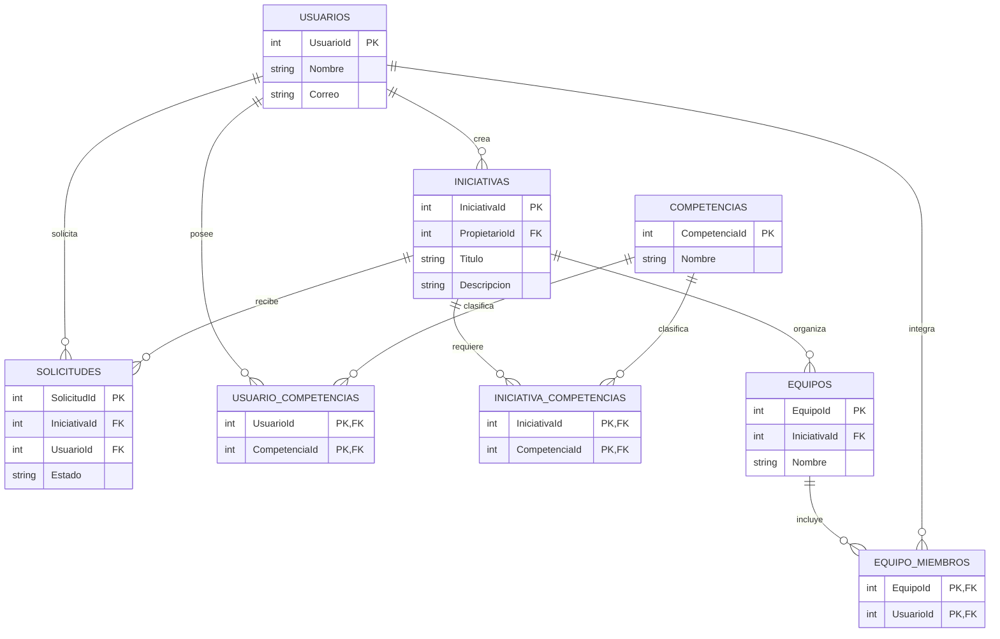

# Diseño del modelo relacional — Innovation Hub

## 2.1 Diagrama entidad-relación

El modelo relacional de Innovation Hub está compuesto por ocho tablas que permiten administrar usuarios, competencias, iniciativas, solicitudes de participación y equipos de trabajo.

El siguiente diagrama representa las relaciones entre las tablas, incluyendo las claves primarias (PK), las claves foráneas (FK) y las relaciones de uno a muchos y muchos a muchos.

El diagrama también se encuentra disponible como imagen en el archivo `docs/diagrama-relaciones.png`.

### Relaciones, tipo y resolución

| Relación | Tipo lógico | Implementación |
|---|---|---|
| Usuario → Iniciativas creadas | 1:N | Iniciativas.PropietarioId |
| Usuario → Solicitudes | 1:N | Solicitudes.UsuarioId |
| Iniciativa → Solicitudes | 1:N | Solicitudes.IniciativaId |
| Usuario ↔ Competencias | N:M | UsuarioCompetencias |
| Iniciativa ↔ Competencias | N:M | IniciativaCompetencias |
| Iniciativa → Equipos | 1:N | Equipos.IniciativaId |
| Equipo ↔ Usuario | N:M | EquipoMiembros |

Las relaciones uno a muchos se implementan mediante claves foráneas en las tablas dependientes.

Las relaciones muchos a muchos se resuelven mediante tablas intermedias con claves primarias compuestas, evitando duplicar asociaciones.

### Del documento a la tabla (modelo propuesto)

La migración de MongoDB a SQL Server requiere transformar los documentos y arreglos en tablas relacionadas.

| Colección o arreglo MongoDB | Destino SQL Server | Motivo |
|---|---|---|
| usuarios | Usuarios | Almacenar los datos de cada usuario |
| competencias | Competencias | Crear un catálogo de habilidades sin duplicados |
| iniciativas | Iniciativas | Registrar las iniciativas y sus propietarios |
| solicitudes | Solicitudes | Registrar las solicitudes de participación |
| equipos | Equipos | Asociar los equipos con las iniciativas |
| usuarios.competencias[] | UsuarioCompetencias | Representar una relación muchos a muchos |
| iniciativas.competenciasRequeridas[] | IniciativaCompetencias | Relacionar iniciativas y competencias mediante JOIN |
| equipos.miembros[] | EquipoMiembros | Relacionar equipos y usuarios sin duplicar información |

**Nota importante:** Las rutas de los arreglos de MongoDB son hipótesis del modelo propuesto. No son campos comprobados del Avance 2. Antes de realizar una migración real, deben verificarse los nombres y las estructuras originales.

---

## 2.2 Descripción de cada tabla

A continuación, se describen las ocho tablas del modelo relacional, incluyendo sus columnas, tipos de datos, nulabilidad, claves y restricciones.

### 2.2.1 Tabla Usuarios

**Propósito:** Almacenar la información básica de las personas registradas en Innovation Hub.

| Columna | Tipo de dato | Permite NULL | Restricciones |
|---|---|---|---|
| UsuarioId | INT IDENTITY(1,1) | No | PRIMARY KEY |
| Nombre | NVARCHAR(100) | No | NOT NULL |
| Correo | NVARCHAR(255) | No | NOT NULL, UNIQUE |

**Clave primaria:** `UsuarioId`.

**Claves foráneas:** No tiene.

**Restricciones:**

- `PRIMARY KEY`: Identifica de forma única a cada usuario.
- `IDENTITY(1,1)`: Genera identificadores numéricos automáticamente.
- `NOT NULL`: Obliga a registrar el nombre y el correo.
- `UNIQUE`: Evita registrar dos usuarios con el mismo correo.

**Relaciones:**

Un usuario puede crear varias iniciativas, realizar varias solicitudes, tener múltiples competencias y pertenecer a distintos equipos.

**Comportamiento de eliminación:** No se permite eliminar un usuario mientras existan registros que lo referencien mediante claves foráneas.

### 2.2.2 Tabla Competencias

**Propósito:** Almacenar el catálogo de habilidades y conocimientos disponibles en la plataforma.

| Columna | Tipo de dato | Permite NULL | Restricciones |
|---|---|---|---|
| CompetenciaId | INT IDENTITY(1,1) | No | PRIMARY KEY |
| Nombre | NVARCHAR(100) | No | NOT NULL, UNIQUE |

**Clave primaria:** `CompetenciaId`.

**Claves foráneas:** No tiene.

**Restricciones:**

- `PRIMARY KEY`: Identifica cada competencia.
- `IDENTITY(1,1)`: Genera el identificador automáticamente.
- `NOT NULL`: Obliga a registrar el nombre.
- `UNIQUE`: Impide registrar competencias con nombres duplicados.

**Relaciones:**

Una competencia puede estar asociada con varios usuarios y puede ser requerida por diferentes iniciativas.

**Comportamiento de eliminación:** No se permite eliminar una competencia mientras esté referenciada en las tablas intermedias.

### 2.2.3 Tabla Iniciativas

**Propósito:** Registrar los proyectos o propuestas creados por los usuarios.

| Columna | Tipo de dato | Permite NULL | Restricciones |
|---|---|---|---|
| IniciativaId | INT IDENTITY(1,1) | No | PRIMARY KEY |
| PropietarioId | INT | No | NOT NULL, FOREIGN KEY |
| Titulo | NVARCHAR(160) | No | NOT NULL |
| Descripcion | NVARCHAR(1000) | Sí | NULL |

**Clave primaria:** `IniciativaId`.

**Clave foránea:** `PropietarioId` referencia `Usuarios(UsuarioId)`.

**Restricciones:**

- Cada iniciativa debe tener un propietario existente.
- El título es obligatorio.
- La descripción es opcional.
- El identificador se genera automáticamente.

**Relaciones:**

- Un usuario puede crear varias iniciativas.
- Una iniciativa puede recibir varias solicitudes.
- Una iniciativa puede tener varios equipos.
- Una iniciativa puede requerir varias competencias.

**Comportamiento de eliminación:** No se permite eliminar una iniciativa mientras existan solicitudes, equipos o asociaciones de competencias que la referencien.

### 2.2.4 Tabla Solicitudes

**Propósito:** Registrar las solicitudes de los usuarios para participar en iniciativas.

| Columna | Tipo de dato | Permite NULL | Restricciones |
|---|---|---|---|
| SolicitudId | INT IDENTITY(1,1) | No | PRIMARY KEY |
| IniciativaId | INT | No | NOT NULL, FOREIGN KEY |
| UsuarioId | INT | No | NOT NULL, FOREIGN KEY |
| Estado | NVARCHAR(20) | No | NOT NULL, DEFAULT, CHECK |

**Clave primaria:** `SolicitudId`.

**Claves foráneas:**

- `IniciativaId` referencia `Iniciativas(IniciativaId)`.
- `UsuarioId` referencia `Usuarios(UsuarioId)`.

**Restricciones:**

- `DEFAULT 'pendiente'`: Asigna automáticamente el estado pendiente cuando no se especifica un valor.
- `CHECK (Estado IN ('pendiente', 'aceptada', 'rechazada'))`: Permite únicamente los tres estados definidos.
- `UNIQUE (IniciativaId, UsuarioId)`: Impide que un mismo usuario registre más de una solicitud para una misma iniciativa.
- `NOT NULL`: Exige una iniciativa, un usuario y un estado.

**Relaciones:**

Cada solicitud pertenece a un usuario y a una iniciativa.

**Comportamiento de eliminación:** No se permite eliminar un usuario o una iniciativa mientras existan solicitudes que los referencien.

### 2.2.5 Tabla Equipos

**Propósito:** Registrar los equipos de trabajo asociados con las iniciativas.

| Columna | Tipo de dato | Permite NULL | Restricciones |
|---|---|---|---|
| EquipoId | INT IDENTITY(1,1) | No | PRIMARY KEY |
| IniciativaId | INT | No | NOT NULL, FOREIGN KEY |
| Nombre | NVARCHAR(100) | No | NOT NULL |

**Clave primaria:** `EquipoId`.

**Clave foránea:** `IniciativaId` referencia `Iniciativas(IniciativaId)`.

**Restricciones:**

- Cada equipo debe pertenecer a una iniciativa existente.
- El nombre del equipo es obligatorio.
- El identificador se genera automáticamente.

**Relaciones:**

Una iniciativa puede tener varios equipos y cada equipo puede estar formado por varios usuarios.

**Comportamiento de eliminación:** No se permite eliminar un equipo mientras existan integrantes registrados en `EquipoMiembros`.

### 2.2.6 Tabla UsuarioCompetencias

**Propósito:** Representar la relación muchos a muchos entre usuarios y competencias.

| Columna | Tipo de dato | Permite NULL | Restricciones |
|---|---|---|---|
| UsuarioId | INT | No | NOT NULL, PRIMARY KEY, FOREIGN KEY |
| CompetenciaId | INT | No | NOT NULL, PRIMARY KEY, FOREIGN KEY |

**Clave primaria compuesta:** `(UsuarioId, CompetenciaId)`.

**Claves foráneas:**

- `UsuarioId` referencia `Usuarios(UsuarioId)`.
- `CompetenciaId` referencia `Competencias(CompetenciaId)`.

**Restricciones:**

La clave primaria compuesta evita registrar dos veces la misma competencia para un usuario.

Ambos identificadores deben existir en sus tablas correspondientes.

**Relación:** Muchos a muchos.

**Comportamiento de eliminación:** No se permite eliminar un usuario o una competencia mientras existan asociaciones que los referencien.

### 2.2.7 Tabla IniciativaCompetencias

**Propósito:** Registrar las competencias requeridas o asociadas con cada iniciativa.

| Columna | Tipo de dato | Permite NULL | Restricciones |
|---|---|---|---|
| IniciativaId | INT | No | NOT NULL, PRIMARY KEY, FOREIGN KEY |
| CompetenciaId | INT | No | NOT NULL, PRIMARY KEY, FOREIGN KEY |

**Clave primaria compuesta:** `(IniciativaId, CompetenciaId)`.

**Claves foráneas:**

- `IniciativaId` referencia `Iniciativas(IniciativaId)`.
- `CompetenciaId` referencia `Competencias(CompetenciaId)`.

**Restricciones:**

La clave primaria compuesta impide asociar dos veces la misma competencia con una iniciativa.

Ambas claves foráneas deben corresponder a registros existentes.

**Relación:** Muchos a muchos.

**Comportamiento de eliminación:** No se permite eliminar una iniciativa o una competencia mientras existan asociaciones que las referencien.

### 2.2.8 Tabla EquipoMiembros

**Propósito:** Registrar los usuarios que forman parte de los equipos de trabajo.

| Columna | Tipo de dato | Permite NULL | Restricciones |
|---|---|---|---|
| EquipoId | INT | No | NOT NULL, PRIMARY KEY, FOREIGN KEY |
| UsuarioId | INT | No | NOT NULL, PRIMARY KEY, FOREIGN KEY |

**Clave primaria compuesta:** `(EquipoId, UsuarioId)`.

**Claves foráneas:**

- `EquipoId` referencia `Equipos(EquipoId)`.
- `UsuarioId` referencia `Usuarios(UsuarioId)`.

**Restricciones:**

La clave primaria compuesta impide registrar dos veces al mismo usuario dentro de un equipo.

Las claves foráneas garantizan que el equipo y el usuario existan.

**Relación:** Muchos a muchos.

**Comportamiento de eliminación:** No se permite eliminar un equipo o un usuario mientras existan asociaciones que los referencien.

### 2.2.9 Comportamiento general de eliminación

Todas las claves foráneas definidas en `sql/schema.sql` utilizan el comportamiento predeterminado `NO ACTION` de SQL Server.

Esto significa que, si un registro principal tiene registros dependientes, SQL Server rechaza su eliminación para proteger la integridad referencial.

Por ejemplo:

- No se puede eliminar un usuario que sea propietario de iniciativas existentes.
- No se puede eliminar una competencia asociada con usuarios o iniciativas.
- No se puede eliminar una iniciativa que tenga solicitudes o equipos relacionados.
- No se puede eliminar un equipo que tenga integrantes registrados.

Para eliminar un registro principal, primero deben resolverse las referencias dependientes.

**No se utiliza `ON DELETE CASCADE` en el modelo actual.**

Esta decisión evita pérdidas accidentales de información y mantiene un control explícito sobre las eliminaciones.

---

## 2.3 Plan de migración de MongoDB a SQL Server

La migración propuesta consiste en transformar la información almacenada en documentos MongoDB en tablas relacionadas de SQL Server, conservando las asociaciones entre los registros.

El proceso se organiza en seis pasos.

### Paso 1 — Inventario de información

Identificar las colecciones utilizadas en MongoDB y revisar su estructura.

Colecciones propuestas:

- `usuarios`
- `competencias`
- `iniciativas`
- `solicitudes`
- `equipos`

Se deben revisar los campos, tipos de datos, identificadores, documentos incompletos y arreglos embebidos.

También es necesario identificar referencias entre documentos y posibles registros duplicados.

Antes de ejecutar una migración real, se deben confirmar los nombres y las estructuras de las colecciones con el Avance 2.

### Paso 2 — Correspondencia entre documentos y tablas

Definir cómo se transformará cada colección MongoDB en una tabla SQL Server.

Las colecciones principales se convertirán en las tablas `Usuarios`, `Competencias`, `Iniciativas`, `Solicitudes` y `Equipos`.

Los arreglos que representen relaciones muchos a muchos se transformarán en tablas intermedias:

- `usuarios.competencias[]` → `UsuarioCompetencias`.
- `iniciativas.competenciasRequeridas[]` → `IniciativaCompetencias`.
- `equipos.miembros[]` → `EquipoMiembros`.

Esta transformación permite consultar las relaciones mediante claves foráneas y operaciones `JOIN`.

Los nombres de estos arreglos son supuestos del diseño y deben comprobarse antes de migrar información real.

### Paso 3 — Orden de creación de tablas

Las tablas deben crearse respetando las dependencias de las claves foráneas.

**Primer grupo: tablas independientes**

1. `Usuarios`
2. `Competencias`

**Segundo grupo: tablas dependientes**

3. `Iniciativas`
4. `Solicitudes`
5. `Equipos`

**Tercer grupo: tablas intermedias**

6. `UsuarioCompetencias`
7. `IniciativaCompetencias`
8. `EquipoMiembros`

Este orden garantiza que las tablas referenciadas existan antes de crear las claves foráneas que dependen de ellas.

El archivo `sql/schema.sql` sigue un orden válido de creación.

### Paso 4 — Conservación de identificadores y referencias

MongoDB utiliza identificadores como `_id` de tipo `ObjectId`, mientras que el modelo SQL Server propuesto utiliza identificadores numéricos `INT IDENTITY(1,1)`.

Por esta razón, no se deben convertir directamente los identificadores `ObjectId` a números enteros.

Para conservar las relaciones, se propone utilizar una tabla temporal de correspondencias con los siguientes campos:

- `coleccion`: Nombre de la colección de origen.
- `mongoId`: Identificador original del documento MongoDB.
- `sqlId`: Nuevo identificador generado en SQL Server.

**Ejemplo de conservación de identificadores**

Supongamos que un usuario tiene el siguiente identificador en MongoDB:

`_id = 65abc123...`

Al insertarlo en SQL Server, recibe un nuevo identificador:

`UsuarioId = 1`

Se registra la correspondencia:

| Colección | ID MongoDB | ID SQL Server |
|---|---|---|
| usuarios | 65abc123... | 1 |

Si una iniciativa pertenece a ese usuario, durante la migración se consulta la correspondencia para asignar el nuevo identificador:

`Iniciativas.PropietarioId = 1`

De esta forma, la iniciativa continúa relacionada con el usuario correcto.

**Nota:** El identificador utilizado es ilustrativo y no corresponde a un documento real del proyecto.

Este procedimiento también debe aplicarse a las referencias de solicitudes, equipos y tablas intermedias.

### Paso 5 — Carga de datos en SQL Server

Después de crear las tablas y preparar las correspondencias, se cargan los registros respetando las dependencias.

**Orden de carga propuesto:**

1. Insertar los usuarios y las competencias.
2. Registrar las correspondencias entre identificadores MongoDB y SQL Server.
3. Insertar las iniciativas utilizando los nuevos identificadores de sus propietarios.
4. Insertar las solicitudes y los equipos utilizando las referencias correspondientes.
5. Insertar los registros de `UsuarioCompetencias`, `IniciativaCompetencias` y `EquipoMiembros`.

Durante la carga se deben validar los campos obligatorios, las restricciones de unicidad y los valores permitidos.

**Datos ficticios de prueba**

El archivo `sql/schema.sql` incluye:

| Tabla | Cantidad de registros |
|---|---:|
| Usuarios | 3 |
| Competencias | 5 |
| Iniciativas | 3 |
| Solicitudes | 2 |
| Equipos | 2 |
| UsuarioCompetencias | 6 |
| IniciativaCompetencias | 5 |
| EquipoMiembros | 4 |
| **Total** | **30** |

Estos registros permiten comprobar las relaciones entre usuarios, iniciativas, competencias y equipos.

Los datos son ficticios y se utilizan únicamente para validar el diseño relacional. No corresponden a una exportación real de MongoDB.

### Paso 6 — Verificación de la migración

Una vez cargados los datos, se deben realizar comprobaciones para verificar que la información se haya conservado correctamente.

**Verificación de cantidades**

Comparar la cantidad de documentos originales de MongoDB con la cantidad de registros migrados a las tablas principales.

**Verificación de relaciones**

Comprobar que las asociaciones existentes en los arreglos de MongoDB se encuentren representadas en las tablas intermedias.

**Verificación de integridad referencial**

Revisar que las claves foráneas apunten a registros existentes y que no se hayan perdido asociaciones durante la migración.

**Verificación de restricciones**

Comprobar que no existan correos duplicados, solicitudes repetidas o estados no permitidos.

**Verificación mediante consultas**

Ejecutar consultas SQL que permitan recuperar usuarios con sus competencias, iniciativas con sus propietarios, equipos con sus integrantes y solicitudes con sus estados.

Finalmente, se deben registrar y corregir las discrepancias detectadas antes de considerar terminada la migración.

---

## Conclusión

El modelo relacional de Innovation Hub propone una estructura de ocho tablas conectadas mediante claves primarias y foráneas.

Las relaciones muchos a muchos se implementan mediante tablas intermedias, mientras que las restricciones `PRIMARY KEY`, `FOREIGN KEY`, `UNIQUE`, `NOT NULL` y `CHECK` contribuyen a mantener la integridad de los datos.

El plan de migración establece seis pasos para transformar la información de MongoDB a SQL Server, conservar los identificadores relacionados y verificar los resultados.

El archivo `sql/schema.sql` proporciona datos ficticios para comprobar el diseño. La migración real queda condicionada a verificar la estructura original de MongoDB utilizada en el Avance 2.